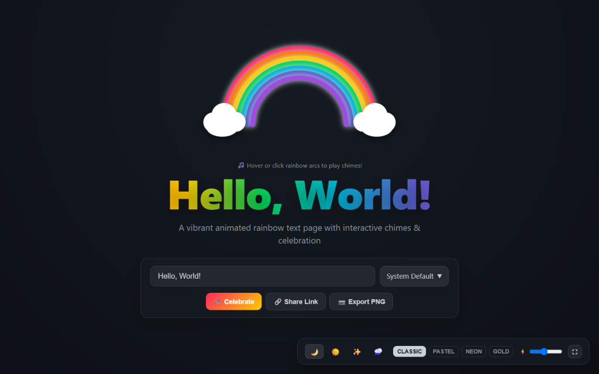

# super-hello-world

Interactive Rainbow Hello World web app with Web Audio chimes, customizable text, themes, confetti, and offline PWA support.

[Live demo](https://okayokay101.github.io/super-hello-world/)



[ภาษาไทย](README_TH.md) · **English**

## Features

### Text and audio
- **Live text customizer:** edit the headline in real time and pick Google Fonts (`Kanit`, `Poppins`, `Montserrat`, `Fredoka`).
- **Web Audio chimes:** play Do–Re–Mi–Fa–Sol–La–Ti notes by hovering or clicking the seven rainbow arcs.
- **Confetti and sparkle trail:** trigger confetti bursts on click or with the Celebrate button, plus a cursor sparkle trail.

### Look and sharing
- **Themes and palettes:** switch between 4 themes (Dark, Day Sky, Starry Night, Rainy) and 4 color palettes (Classic, Pastel, Neon, Gold).
- **Snapshot and share:** download a PNG card, share custom text via `?msg=YourMessage`, and toggle fullscreen or animation speed.
- **PWA and accessibility:** offline caching via [`sw.js`](sw.js), [`manifest.json`](manifest.json), and `prefers-reduced-motion` support.

## Requirements

- Any modern desktop or mobile browser with Web Audio API and Canvas support
- Python 3 (or any static HTTP server) when running locally so [`sw.js`](sw.js) can register

## Setup

```bash
git clone https://github.com/OkayOkay101/super-hello-world.git
cd super-hello-world
python -m http.server 8000
```

Open `http://localhost:8000` in your browser. Serving over HTTP ensures the Service Worker (`sw.js`) registers properly.

## Project layout

- `index.html`: complete app markup, styles, and interactive JavaScript
- `manifest.json`: PWA web app manifest
- `sw.js`: Service Worker for offline caching
- `docs/images/screenshot.png`: main interface screenshot
