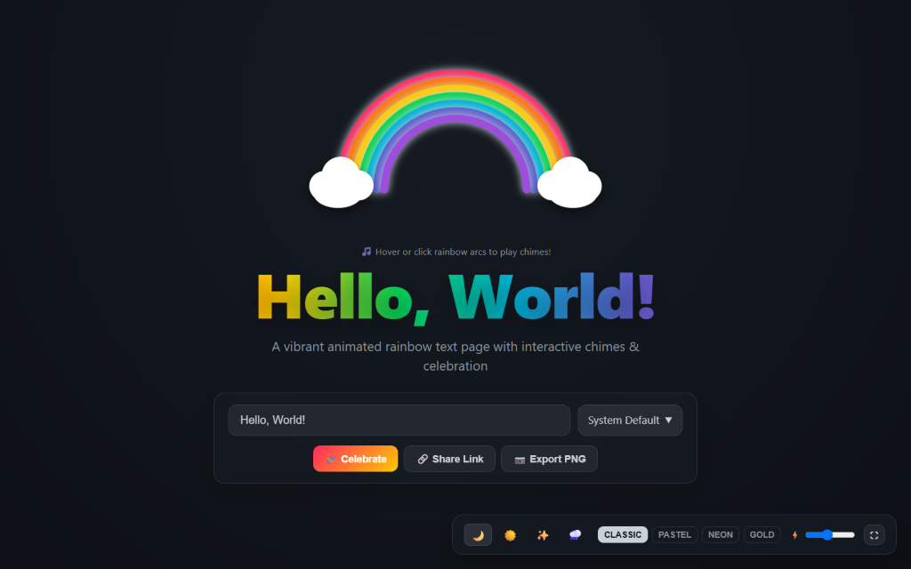

# super-hello-world

เว็บแอปพลิเคชันสายรุ้งแบบอินเทอร์แอคทีฟพร้อมเสียงโน้ตดนตรี Web Audio, ข้อความปรับแต่งได้, ธีม, พลุกระดาษ และรองรับ PWA แบบออฟไลน์

[ดูหน้าเว็บจริง](https://okayokay101.github.io/super-hello-world/)



**ภาษาไทย** · [English](README.md)

## ฟีเจอร์

### ข้อความและเสียง
- **ปรับแต่งข้อความสด:** พิมพ์เปลี่ยนข้อความหลักได้ทันที พร้อมเลือกฟอนต์จาก Google Fonts (`Kanit`, `Poppins`, `Montserrat`, `Fredoka`)
- **เสียงโน้ต Web Audio:** เล่นโน้ต Do–Re–Mi–Fa–Sol–La–Ti เมื่อเลื่อนเมาส์ผ่านหรือคลิกที่เส้นรุ้งทั้ง 7 สี
- **พลุกระดาษและละอองดาว:** ยิงพลุเฉลิมฉลองเมื่อคลิกหรือกดปุ่ม Celebrate พร้อมละอองดาวตามตำแหน่งเคอร์เซอร์

### ธีมและการแชร์
- **ธีมและพาเลตต์สี:** สลับได้ 4 ธีม (Dark, Day Sky, Starry Night, Rainy) และ 4 ชุดสี (Classic, Pastel, Neon, Gold)
- **บันทึกภาพและแชร์ลิงก์:** ส่งออกการ์ดเป็นไฟล์ PNG, แชร์ข้อความผ่าน `?msg=YourMessage` และปรับความเร็วแอนิเมชันหรือเต็มจอ
- **PWA และการเข้าถึง:** แคชใช้งานออฟไลน์ผ่าน [`sw.js`](sw.js), [`manifest.json`](manifest.json) และรองรับ `prefers-reduced-motion`

## ข้อกำหนด

- เบราว์เซอร์สมัยใหม่บนเดสก์ท็อปหรือมือถือที่รองรับ Web Audio API และ Canvas
- Python 3 (หรือเว็บเซิร์ฟเวอร์ไฟล์สถิตใด ๆ) เมื่อรันในเครื่องเพื่อให้ [`sw.js`](sw.js) ลงทะเบียนได้

## การติดตั้ง

```bash
git clone https://github.com/OkayOkay101/super-hello-world.git
cd super-hello-world
python -m http.server 8000
```

เปิด `http://localhost:8000` ในเบราว์เซอร์ การรันผ่าน HTTP ช่วยให้ Service Worker (`sw.js`) ทำงานได้สมบูรณ์

## โครงสร้างโปรเจกต์

- `index.html`: โครงสร้างหน้าเว็บ สไตล์ และสคริปต์ทั้งหมด
- `manifest.json`: ไฟล์กำหนดค่า PWA
- `sw.js`: Service Worker สำหรับแคชใช้งานออฟไลน์
- `docs/images/screenshot.png`: ภาพหน้าจอหลักของแอป
